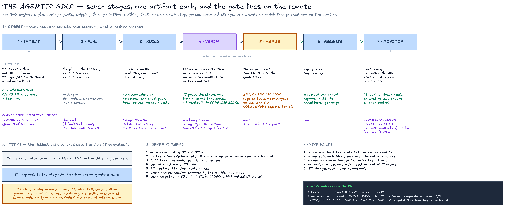
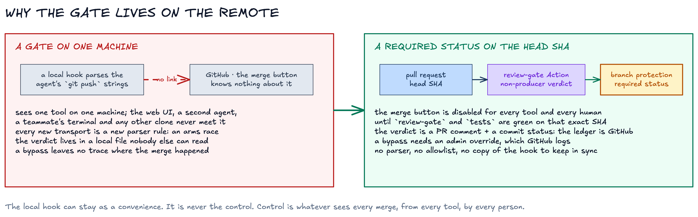

# agentic-sdlc

A two-page software development lifecycle for small teams that build with coding agents, plus the files that make it mechanical. The gate lives on the remote: a pull request merges only when GitHub sees a required `review-gate` status on the head SHA, posted from a structured verdict by a reviewer that did not write the code.

Read [`SDLC.md`](SDLC.md) first. It is the whole method: three tiers, seven stages with one artifact each, seven governed numbers, five rules.



## Why the gate lives on the remote



A gate that runs on one machine sees one tool. The web UI, a second agent, a teammate's terminal and every other clone never meet it. Every new way to push is a new parser rule, so the hook grows and still leaks. Its verdict lives in a local file nobody else can read, and a bypass leaves no trace where the merge actually happened.

A required status check on the head SHA has none of those problems. The merge button is disabled for every tool and every human until `review-gate` and your test job are green on that exact commit. The verdict is a pull request comment plus a commit status, so GitHub is the ledger. A bypass needs an admin override, which GitHub logs. There is no parser, no allowlist and no copy of a hook to keep in sync. The local hook can stay as a convenience; it is never the control.

## What is in the kit

| Path | What it is |
|---|---|
| `SDLC.md` | the lifecycle, two pages |
| `templates/CLAUDE.md` | a project instruction file under 100 lines that imports `SDLC.md` |
| `templates/CODEOWNERS.example` | T2 paths mapped to required human approvers |
| `templates/pull_request_template.md` | tier, plan, `Spec:` link for T2 |
| `templates/adr.md` | one-page T2 spec: threat model and rollback |
| `templates/incidents-README.md` | incident format with `status:` and `regression:` front matter |
| `templates/.github/workflows/review-gate.yml` | runs the non-producer reviewer on the head SHA, posts the `review-gate` commit status |
| `templates/.github/workflows/incident-check.yml` | a closed incident must reference an existing test path or a named control |
| `templates/claude/settings.json` | project permissions: deny force-push and direct push, plan mode by default, tests after edits |
| `agents/reviewer.md` | the read-only reviewer subagent |
| `scripts/classify-change.sh` | paths changed → T0, T1 or T2 |
| `scripts/parse-verdict.sh` | extracts `- **Verdict**: PASS|REVISE|BLOCK` from a review comment |
| `scripts/tree-unchanged.sh` | proves a squash left the graded tree unchanged |
| `scripts/check-incident-frontmatter.sh` | the incident closure rule, runnable locally and in CI |
| `install.sh` | copies the templates into a target repository and prints the branch-protection settings a human must set |

`SDLC.md`'s Claude Code mapping table has a "model by job" row: Haiku 5.5 for classification and exploration, Sonnet 5.5 for builds and T1 review, Opus 5.5 for T2 verdicts and architecture. The `review-gate` workflow follows it — Opus 5.5 grades T2 verdicts, Sonnet 5.5 grades T1.

## Install into a repository

```bash
git clone https://github.com/isatimur/agentic-sdlc ~/Dev/agentic-sdlc
cd /path/to/your/repo
~/Dev/agentic-sdlc/install.sh
```

Then, once, on GitHub (a human with admin rights):

1. Settings → Branches → protect your integration branch. Require status checks `tests` and `review-gate`. Require a pull request. Require review from Code Owners.
2. Settings → Secrets → add `ANTHROPIC_API_KEY` for the `review-gate` workflow.
3. Fill `CODEOWNERS` with your T2 paths and approvers.

`install.sh` prints these three steps with your branch name filled in.

## Honest limits

- Branch protection and required status checks are available on public repositories under GitHub Free, and on private repositories only with GitHub Pro, Team or Enterprise. On a private repository under Free, the `review-gate` status is informative, not enforced.
- The `review-gate` workflow has passed this repository's own CI but has not yet gated a pull request in a consumer repository. The first consumer proves it; until then treat it as 0.1.
- For T2 the workflow posts one model's verdict. The second model family and the human approval come from Code Owner review, not from the workflow.
- The tier classifier matches paths, not diff content. A dangerous change under a harmless path is a T1 until a human raises it in the pull request, which the template asks for.
- Bypass counting from the GitHub API is described in `SDLC.md` and not yet scripted.

## What the kit deliberately does not contain

No markdown verdict ledger, no dispatch log, no claims ledger, no sentinel, no dead-man switch, no autonomy-grant prose, no fifteen-rule charter. Pull request statuses and comments are the ledger. Alerts are your observability tool's job.

## Versioning

Consumers pin a tag. Changes are listed in [`CHANGELOG.md`](CHANGELOG.md). A change to a governed number in `SDLC.md` is a minor version; a change to a rule is a major version.

## Where it came from

Extracted on 2026-09-28 from a heavier agency-wide design after an audit found the gate guarding the wrong boundary. The audit and the reasoning are in that project's records; the kit keeps only what caught real bugs.

MIT license.
